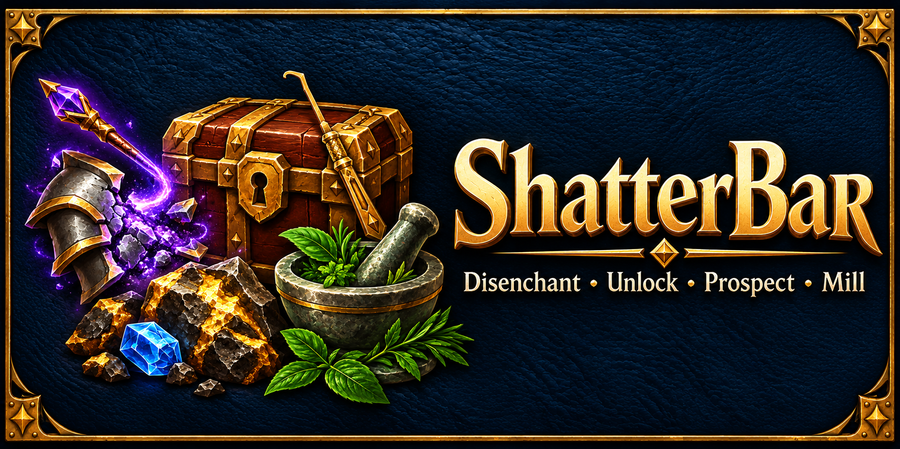

# ShatterBar

Compact World of Warcraft profession bars by **Arametheus**, made as a companion
to [Mailwright](https://github.com/VampiresInc/Mailwright).

Find items you can disenchant, prospect, mill, or unlock without searching through
your bags. Click an item on its bar, or bind a key to process the first available item.

## Features

- Automatic bars for learned disenchanting, prospecting, milling, and rogue lockpicking.
- Item counts and available batches, with configurable scale, font size, and direction.
- A keybinding for the first available item, plus separate bindings for each profession.
- Lockboxes stay on the bar after unlocking: click again to open and loot.
- Disenchanting filters for soulbound, warbound, equipment-set items, and tabards.
- Right-click an item to ignore its type; restore ignored items through settings.
- Optional Retail Warband Bank ore and herbs, with carried materials preferred.
- Settings directly in the game's AddOns panel.
- Automatic client language or a saved language override.

Every click or key press performs one action or one processing batch. Combat and
casting pause processing. ShatterBar does not move or combine material stacks.

## Installation

Download the ZIP matching your client and extract it into `Interface/AddOns`.
The resulting path should be `Interface/AddOns/ShatterBar/ShatterBar.toc`.
Restart WoW after first installation and enable ShatterBar in the AddOns list.

Type `/sb`, `/shatter`, or `/shatterbar` to open **Settings > AddOns > ShatterBar**
(**Interface > AddOns** on older clients). Shift-drag a profession icon to move
its bar. Right-click the profession icon to open settings.

Assign keys in ShatterBar's settings or **Key Bindings > ShatterBar**. Assigning a
key replaces its previous action. The general binding chooses the first nonempty
available bar: Disenchant, Prospect, Mill, then Pick Lock. Right-clicking an item
ignores its type; it does not open an unlocked box. Left-click to open it instead.

## Retail recipes and Warband Bank

Retail prospecting and milling use learned expansion-specific recipes. If a bar
is missing, open Jewelcrafting or Inscription once to populate recipe data. The
profession icon opens the relevant profession.

Warband ore and herb support are separate experimental settings, both off by
default. Bank-only entries have a **W** marker. Open the bank or keep the relevant
profession open so the game exposes live bank targets; opening its material picker
may also be necessary. Closing the profession can remove remote access. Personal
bank items and cached inventory without a live target are excluded.

Recipe batches use their mapped size: usually five materials, with some newer
milling recipes requiring ten. Each stack must contain a complete batch.

## Languages

English is the default fallback. German, French, Spanish (Spain and Latin America),
Italian, Brazilian Portuguese, Russian, Korean, Simplified Chinese, and Traditional
Chinese translations are included. Choose **Automatic (client language)** or an
override under **Language**, then click **Reload UI**. The choice saves account-wide.
Blizzard's item and spell text continues to use the client language. Translations
and their layouts still need native-speaker and in-game review.

[Report an issue](https://github.com/VampiresInc/ShatterBar/issues) | [Source code](https://github.com/VampiresInc/ShatterBar)

## Troubleshooting

`/sb status` reports the version and listed items. `/sb debug`, `/sb prospectdebug`,
and `/sb milldebug` record diagnostics; `/reload` writes them to SavedVariables.
Reports can contain item links and item instance identifiers; review before sharing.

For a bug report, include client/build, ShatterBar version, profession, item name/ID,
steps to reproduce, and any Lua error. Do not upload your entire WTF folder.

## Credits

With thanks to Molinari's original authors and maintainers for the bundled item data.
ShatterBar is an independent project, released under the [All Rights Reserved license](LICENSE).
Bundled Molinari data retains its MIT license; see [third-party notices](THIRD_PARTY_NOTICES.md).
