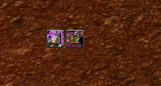
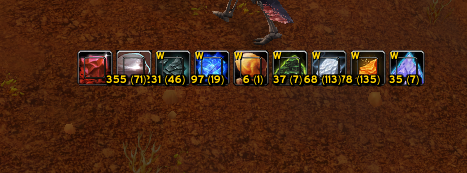
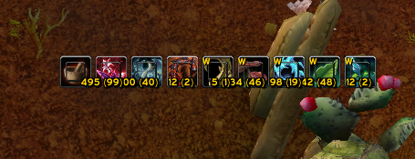
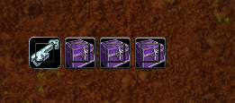
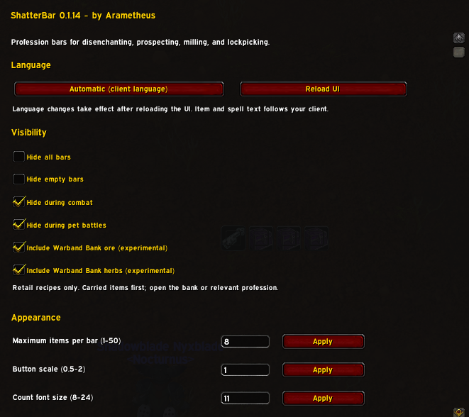
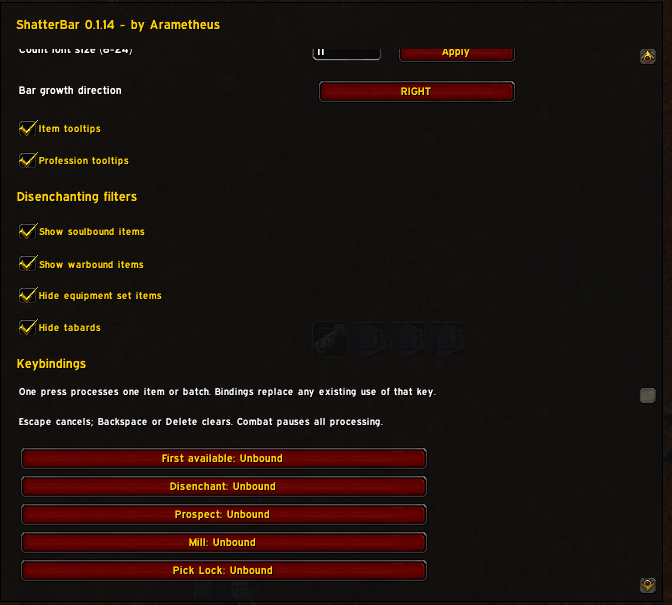
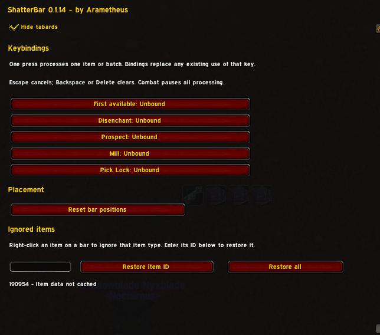

# ShatterBar screenshots

Captured in Retail with ShatterBar 0.1.14. Options are kept as separate images so the text remains readable.

## Profession bars

### Disenchanting

### Prospecting, including Warband Bank materials marked W

### Milling, including Warband Bank materials marked W

### Lockpicking

## AddOns options

### Language, visibility, and appearance

### Disenchanting filters and keybindings

### Keybindings, placement, and ignored items

Images retain the original supplied PNG pixels and dimensions.
